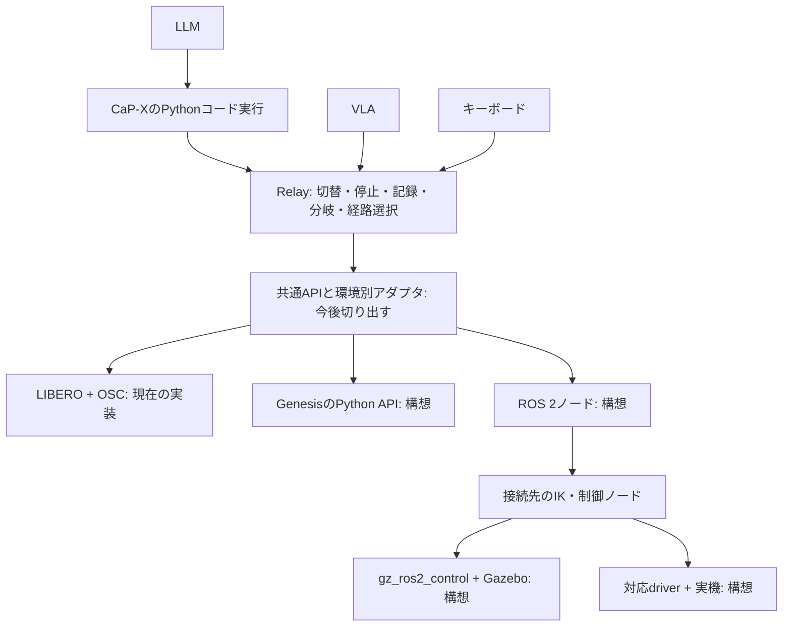

# ROS 2・Gazebo・Genesisの接続位置（提出後の拡張案）

現在の動作確認はLIBERO／OSCのみ。以下の共通APIへの分離と追加接続は未実装。
CaP-Xのコード実行器を利用しつつ、Relayの切替・停止・記録・分岐・経路選択を環境依存部分から切り出す。

## どこを書き換えるか

- `capx/extensions/vla/env.py`：現在は`OscLiberoEnv`が観測取得・相対OSC操作・MuJoCo状態復元を行う。
  観測・操作・停止・状態保存の能力を共通の接続口として切り出す。
- `capx/extensions/vla/api.py`：現在の`move_to_pose`はOSCのスケールや手先姿勢に直接依存する。
  接続先の制御器を呼ぶ部品へ分離する。CaP-Xの`BaseEnv`を実装するだけで全機能が移植できるわけではない。
- `capx/extensions/vla/recording.py`：現在はMuJoCoの時刻・physics stateも参照する。
  環境ID・指令の契約・観測・時刻・backend固有の状態を区別して保存する。
- `capx/extensions/hybrid/history.py`：環境固有のsnapshot取得・復元を呼び出す。
  各環境で対応可否を示し、未対応の復元操作は利用させない。

## 接続先ごとに追加するもの

| 接続先 | 指令と観測の処理 | 検証すること |
|---|---|---|
| Genesis | Python APIで観測取得。手先目標からIK・関節位置制御などへ変換 | 座標系・単位・周期・制御器・状態復元 |
| ROS 2 | topic／action通信で制御ノードへ指令。画像・関節状態・手先姿勢を受信 | 時刻対応・通信遅延・停止・指令の意味と制御周期 |
| Gazebo | ROS 2経由ならgz_ros2_controlと必要な制御ノードへ接続 | 観測と指令の対応、sim固有の保存・復元 |
| 実機 | ROS 2対応driverなど、実機の制御口へ接続 | 停止・速度／可動範囲・物理的な再開状態の準備 |

Genesisへ直接接続する場合、ROS 2を必須にはしない。
ROS 2はシミュレータではなく、起動したノード間の通信・制御系への接続に使う。
VLAのactionを関節指令へそのまま流すのではなく、指令の座標系・単位・制御の意味を合わせる。
また、APIの接続ができても、学習済みVLAが別環境へ汎化するかは別途評価する。

共通APIの切り出し → 接続先を一つ追加 → キーボードで確認 → VLA・コードを接続 → 状態復元を検証、の順で進める。
実機では物体も含む過去の状態を瞬時に復元できないため、ログの分岐と物理的な再開準備を分ける。

参考：[Genesis公式](https://genesis-world.readthedocs.io/en/latest/user_guide/getting_started/control_your_robot.html)、
[gz_ros2_control公式](https://control.ros.org/jazzy/doc/gz_ros2_control/doc/index.html)。
