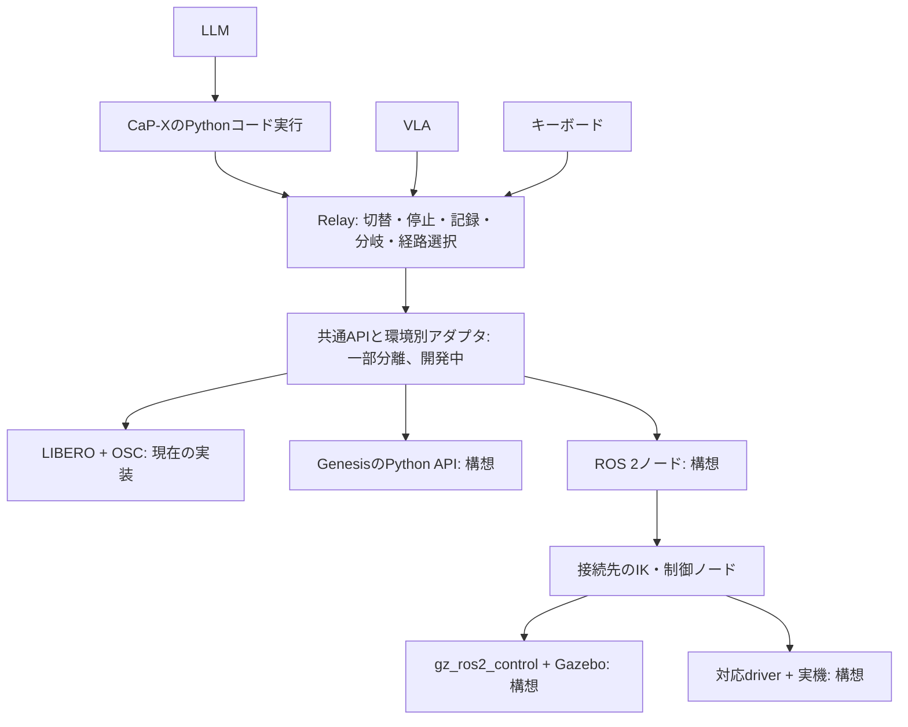

# ROS 2・Gazebo・Genesisの接続位置（提出後の拡張案）

現在の動作確認はLIBERO／OSCのみ。共通APIへの分離を開始し、追加接続は未実装。
CaP-Xのコード実行器を利用しつつ、Relayの切替・停止・記録・分岐・経路選択を環境依存部分から切り出す。

提出版は`pai-final-20261102`タグで固定し、開発は`feat/environment-adapters`で進める。
このブランチの最初の変更では、以下の境界だけを切り出した。

| 接続口 | 意味 | 現在のLIBERO実装 |
|---|---|---|
| `eef_pose()` | WORLDの手先位置（m）と3×3姿勢行列 | MuJoCoのEEF siteを読む |
| `cartesian_delta_action()` | WORLDの並進（m）・回転ベクトル（rad）・開閉をnative指令へ変換 | OSCのスケールを用いた相対7次元指令 |
| `gripper_action()` | 手先を維持する開閉指令を構築 | OSCの手先6軸をゼロにした指令 |
| `simulation_time()` | 記録用のシミュレーション時刻（秒） | MuJoCoの時刻を読む |

契約は`relay/backends/base.py`に置き、CaP-X・LIBERO・MuJoCoをimportしない。
変換関数だけでは動かさず、既存の`apply_native()`が権限・epoch・停止・記録を確認して実行する。
`VlaApi.move_to_pose()`／開閉ツールと記録器がこの境界を利用する。
LIBEROの変換実装は、当面`OscLiberoEnv`に残している。

これは環境全体を移植できるAPIの完成ではない。
観測・native指令契約・停止・時計の種類・snapshot対応可否・キーボードの座標変換は、引き続き分離が必要。
特にキーボードの7次元OSC操作、physics stateの形式、巻き戻しの実装はLIBEROに依存する。
8次元の絶対手先指令を使う数値テストbackendでもツールを検証するが、Genesis／ROS 2の実装とは扱わない。



## どこを書き換えるか

- `capx/extensions/vla/env.py`：現在は`OscLiberoEnv`が観測取得・相対OSC操作・MuJoCo状態復元を行う。
  観測・操作・停止・状態保存の能力を共通の接続口として切り出す。
- `capx/extensions/vla/api.py`：`move_to_pose`からOSC固有のスケール参照を除き、
  `OscLiberoEnv.cartesian_delta_action()`へ移動済み。
  手先までのフィードバック処理とCaP-XのAPI登録はここに残す。CaP-Xの`BaseEnv`を実装するだけで全機能が移植できるわけではない。
- `capx/extensions/vla/recording.py`：時刻は`simulation_time()`経由に変更済みで、既存の`sim_time_s`を維持する。
  環境ID・指令の契約・観測・時刻・backend固有の状態を区別して保存する。
- `capx/extensions/hybrid/history.py`：環境固有のsnapshot取得・復元を呼び出す。
  各環境で対応可否を示し、未対応の復元操作は利用させない。

## 接続先ごとに追加するもの

| 接続先 | 指令と観測の処理 | 検証すること |
|---|---|---|
| Genesis | Python APIで観測取得。手先目標からIK・関節位置制御などへ変換 | 座標系・単位・周期・制御器・状態復元 |
| ROS 2 | topic／action通信で制御ノードへ指令。画像・関節状態・手先姿勢を受信 | 時刻対応・通信遅延・停止・指令の意味と制御周期 |
| Gazebo | ROS 2経由ならgz_ros2_controlと必要な制御ノードへ接続 | 観測と指令の対応、sim固有の保存・復元 |
| 実機 | ROS 2対応driverなど、実機の制御口へ接続 | 停止・速度／可動範囲・物理的な再開状態の準備 |

Genesisへ直接接続する場合、ROS 2を必須にはしない。
ROS 2はシミュレータではなく、起動したノード間の通信・制御系への接続に使う。
VLAのactionを関節指令へそのまま流すのではなく、指令の座標系・単位・制御の意味を合わせる。
また、APIの接続ができても、学習済みVLAが別環境へ汎化するかは別途評価する。

共通APIの切り出し → 接続先を一つ追加 → キーボードで確認 → VLA・コードを接続 → 状態復元を検証、の順で進める。
実機では物体も含む過去の状態を瞬時に復元できないため、ログの分岐と物理的な再開準備を分ける。

## 最初の分離の確認（2026-11-02）

```bash
CAPX_LIBERO_SOURCE=capx/third_party/LIBERO-PRO \
  .local/openvla-sim/bin/python -m pytest \
  tests/test_backend_boundary.py tests/test_vla_extension.py tests/test_hybrid_control.py \
  -q --disable-warnings
node --test tests/web/hybrid-keyboard.test.mjs tests/web/hybrid-graph.test.mjs
```

macOSの既存専用venv（上記パス）でPythonは53件成功、依存先の警告15件、skipなし。
JavaScriptは12件成功。別環境ではLIBERO依存を用意したPythonに読み替える。
LIBEROを指定しない実行では実物理テストがskipされるため、同じ検証結果とは扱わない。

- 同一checkpointから、提出時のOSCスケール式と新しい変換口で同じ2操作を実行し、
  native指令・各操作後のphysics stateが配列の完全一致、時刻が一致することを確認した。
- 8次元絶対手先指令の数値テストbackendでも、手先移動・開閉・epoch切替時の中断・記録時刻を確認した。
- 既存のCaP-X実行器、VLA通信、制御主体切替、記録・再実行・分岐・巻き戻しのテストも通過した。

GPU上の実モデル推論や、ROS 2／Gazebo／Genesisの接続試験はこの変更では行っていない。

参考：[Genesis公式](https://genesis-world.readthedocs.io/en/latest/user_guide/getting_started/control_your_robot.html)、
[gz_ros2_control公式](https://control.ros.org/jazzy/doc/gz_ros2_control/doc/index.html)。
