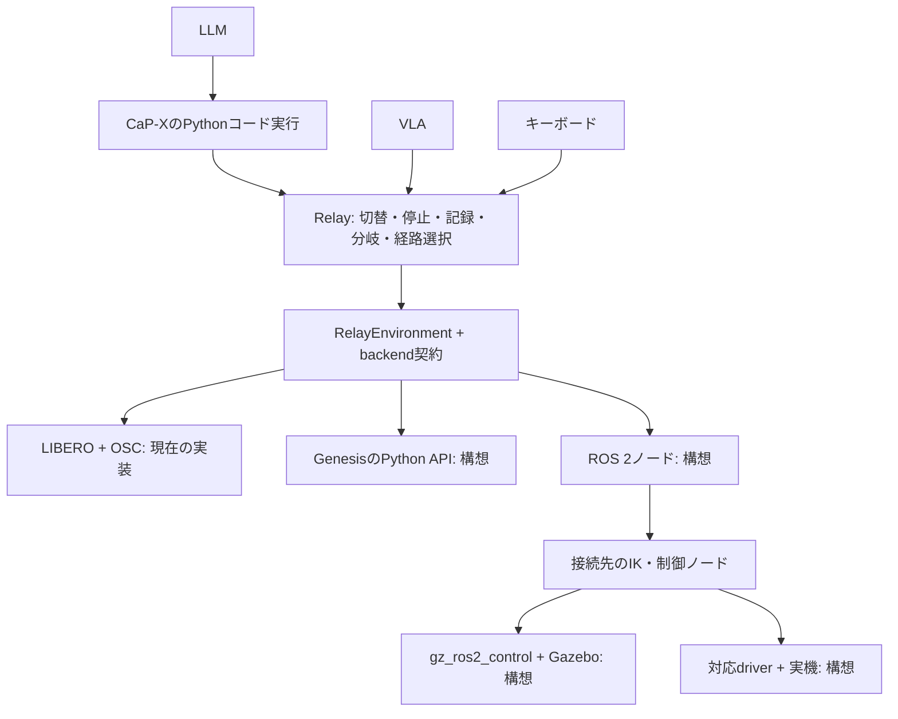

# ROS 2・Gazebo・Genesisの接続位置（提出後の拡張案）

実物理の動作確認はLIBERO／OSC。共通実行とbackendを分離し、外部のPython adapterを読み込む接続口を実装した。
Genesis・ROS 2・Gazeboの実adapterはまだ追加していない。
提出版は`pai-final-20261102`、開発は`feat/environment-adapters`で固定する。

## LIBERO依存の整理と現在の配置

| 処理 | 配置 | 共通化した境界 |
|---|---|---|
| 指令期限・停止・権限・記録・step数 | `relay/environment.py` | `RelayEnvironment.apply_native()`が唯一の物理step入口 |
| native指令の意味・次元・検証 | 各backend | `action_contract`と`validate_chunk()`。7次元を共通側で仮定しない |
| 観測・VLA／VLM用画像・表示用画像 | 各backend | `get_observation()`・`policy_observation()`・`code_observation()`・`display_images()` |
| キーボードの操作量からnative指令への変換 | 各backend | `teleop_action(axes, gripper)`。入力受付threadでは変換しない |
| 手先の物理単位の指令からnative指令への変換 | 各backend | `eef_pose()`・`cartesian_delta_action()`・`gripper_action()` |
| 時計・診断／再実行用状態ベクトル | 各backend | `simulation_time()`・`physics_state()` |
| 物理・制御器・乱数・描画の復元 | 各backend | optional `capture_checkpoint()`・`restore_checkpoint()` |
| 数値／JSONのcheckpoint保存形式 | `relay/checkpoints.py` | backend固有のpayloadをpickleなしで保存 |
| CaP-Xコード実行・API登録 | `capx/extensions/vla/api.py` | 共通環境をCaP-X実行器につなぐ |
| 制御主体の切替・分岐図・経路採用・Web配信 | `capx/extensions/hybrid/` | 共通環境を利用し、LIBEROのhandleを参照しない |
| LIBERO生成・初期化・OSC・画像向き・MuJoCo状態 | `relay/backends/libero.py` | `LiberoBackend`だけに集約 |

`capx/extensions/vla/env.py`には既存呼出し用の`OscLiberoEnv`と、CaP-X用の`BackendEnv`を残す。
古い診断コードの`env.handle`等も互換用に残すが、新しい共通処理からは使わない。
上流CaP-Xの既存シミュレータ実装やOpenVLA固有の画像前処理まで移動したものではない。
切替・記録・UIのモジュールもまだCaP-X拡張内にあり、独立パッケージ化は未完了。

## backendの契約

`relay/backends/base.py`の`EnvironmentBackend`に従う。

- 生成・reset・観測・変換・step・復元・closeはowner threadで実行する。
  LIBEROのOpenGL context選択とMuJoCo／OSC内部状態の復元処理は専用backendに維持する。
- 手先位置はWORLDのm、姿勢はEEF→WORLDの3×3回転行列、回転指令はWORLDの軸角rad。
  開閉の共通指令は`-1=open, +1=close`で、実機固有の値にはbackendが変換する。
- `teleop_action()`は6軸の正規化された操作意図と開閉指令を受ける。native actionではない。
  backendのmetadataに座標系・並進／回転ゲイン・周期を残す。
  LIBEROは提出版と同じ正規化OSC操作量を維持する。
- native指令の次元・単位・範囲はbackendとモデルの`action_contract`で一致させる。
  `PolicyBridge`も選択した契約で初期化し、異なる契約のworkerを接続させない。
- `step_native()`は上限のある一回の制御実行として`BackendTransition`を返す。
  `stop()`は停止／holdを行い、架空のstepを記録しない。Esc・deadman解除のholdはowner threadで処理する。
  自律的に動く通信先では制御器側にも指令の期限が必要。共通Pythonクラスだけで実機停止を保証するものではない。
- `display_images()`は任意名の表示用RGB配列。1〜32台、名前は`[A-Za-z0-9_-]{1,80}`、画像はuint8 H×W×3。
  初期主表示は辞書の先頭、画面上で主表示・配置を変更できる。
  `policy_observation()`の画像と規約は別に保持し、LIBEROのraw画像の向きを変更しない。
  LLM／VLM用は`code_observation()`が`rgb_top_left`画像を返す。LIBEROの既存の180度回転も専用backendへ移した。
- `BackendCapabilities`で`checkpoints`・`state_replay`・`cartesian_control`・`reset`を明示する。
  checkpoint非対応なら記録は続け、タイムラインは作らない。reset非対応なら新しい試行を拒否する。
  `physics_state()`は診断ベクトルであり、それだけで完全復元できるとは扱わない。
  再実行非対応の環境では、機械的な`replay_actions()`コードを学習候補として生成しない。
- snapshotはbackendとaction契約、モデル／reset内で検証する。別モデルやreset前の状態へは戻さない。
  旧LIBERO checkpointの数値payloadは維持している。別プロセスの保存セッションは従来どおり再実行で再構成する。

## 追加と起動

built-inは`libero`と、数値参照実装の`kinematic`。
外部adapterは`load_backend("your_package.backend:YourBackend", config)`で読み込む。
factoryはJSON設定をキーワード引数として受け、契約を満たすbackendを返す。
これはローカルの信頼したPythonコードを読み込む仕組みである。

```bash
# LIBERO（従来の起動コマンドは --backend 指定なしでも動く）
python -m capx.extensions.hybrid.server \
  --backend libero --output output/libero-session

# GPU・LIBERO不要の接続確認。物理シミュレーションや実モデル推論ではない
python -m capx.extensions.hybrid.server \
  --backend kinematic --output output/backend-reference \
  --port 8877 --test-vla --test-llm --test-operator

# 新しいbackend。JSONファイルはfactoryへ渡す設定のオブジェクト
python -m capx.extensions.hybrid.server \
  --backend your_package.backend:YourBackend \
  --backend-config backend.json --output output/other-simulator
```

`kinematic`は8次元の絶対XYZ＋WXYZ＋開閉指令で、LIBEROの7次元相対OSCとは異なる。
操作・記録・コード実行・分岐がnativeの7次元形式に依存しないことを確認するための参照実装である。
`--test-vla`はowner threadで構築した一定の試験指令を繰り返すもので、VLAモデルではない。
絶対目標を使うbackendでは同じ目標に保持される。実VLAの動作・汎化の証拠にはしない。
実モデルは選択したaction契約に対応するworkerを接続する。



## 接続先ごとに追加するもの

| 接続先 | 指令と観測の処理 | 検証すること |
|---|---|---|
| Genesis | Python APIで観測取得。手先目標からIK・関節位置制御などへ変換 | 座標系・単位・周期・制御器・状態復元 |
| ROS 2 | topic／action通信で制御ノードへ指令。画像・関節状態・手先姿勢を受信 | 時刻対応・通信遅延・停止・指令の意味と制御周期 |
| Gazebo | ROS 2経由ならgz_ros2_controlと必要な制御ノードへ接続 | 観測と指令の対応、sim固有の保存・復元 |
| 実機 | ROS 2対応driverなど、実機の制御口へ接続 | 停止・速度／可動範囲・物理的な再開状態の準備 |

Genesisへ直接接続する場合、ROS 2を必須にはしない。
ROS 2はシミュレータではなく、起動したノード間の通信・制御系への接続に使う。
VLAのactionを関節指令へそのまま流すのではなく、指令の座標系・単位・制御の意味を合わせる。
また、APIの接続ができても、学習済みVLAが別環境へ汎化するかは別途評価する。

共通APIを通して接続先を一つ追加 → キーボードで確認 → VLA・コードを接続 → 状態復元を検証、の順で進める。
実機では物体も含む過去の状態を瞬時に復元できないため、ログの分岐と物理的な再開準備を分ける。

## 検証（2026-11-02）

```bash
CAPX_LIBERO_SOURCE=capx/third_party/LIBERO-PRO \
  .local/openvla-sim/bin/python -m pytest \
  tests/test_backend_runtime.py tests/test_backend_boundary.py \
  tests/test_vla_extension.py tests/test_hybrid_control.py \
  -q --disable-warnings
node --test tests/web/hybrid-keyboard.test.mjs tests/web/hybrid-graph.test.mjs
```

macOSの既存専用venv（上記パス）でPythonは63件成功、skipなし。
JavaScriptは12件成功。別環境ではLIBERO依存を用意したPythonに読み替える。
LIBEROを指定しない実行では実物理テストがskipされるため、同じ検証結果とは扱わない。

- 同一checkpointから、提出時のOSCスケール式と新しい変換口で同じ2操作を実行し、
  native指令・各操作後のphysics stateが配列の完全一致、時刻が一致することを確認した。
- 分離前の`9a3d854`と今回のLIBERO実装へ同じ20指令を与え、初期状態を含む21組のintegration state・手先姿勢と、42枚のrawカメラ画像の完全一致を確認した。
- 8次元絶対手先指令のbackendでも、手先移動・開閉・VLA形式の指令・CaP-Xコード実行・停止・記録・分岐・採用経路固定を確認した。
- checkpoint非対応時の記録／次の試行、reset／手先移動非対応の拒否、owner threadでの停止を確認した。
- 外部module:Factoryで3カメラの参照backendを起動し、ブラウザでカメラ名・配信・レイアウトを確認した。
- 既存のCaP-X実行器、VLA通信、制御主体切替、記録・再実行・分岐・巻き戻しのテストも通過した。

GPU上の実モデル推論や、ROS 2／Gazebo／Genesisの接続試験はこの変更では行っていない。

参考：[Genesis公式](https://genesis-world.readthedocs.io/en/latest/user_guide/getting_started/control_your_robot.html)、
[gz_ros2_control公式](https://control.ros.org/jazzy/doc/gz_ros2_control/doc/index.html)。
