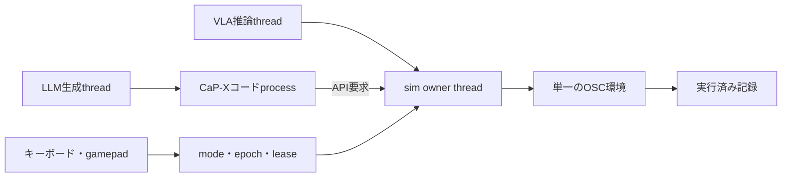

# VLA・LLMコード・人間を同じ環境で切り替える

CaP-Xの追加branch `codex/vla-integration` の機能。
[既存のVLA/OSC起動手順](vla-osc.md)と同じsim専用venv・LIBERO-PRO submoduleを使う。
ROS 2は使わず、一つのMuJoCo環境と共通の実行済み記録を共有する。

## 起動

まず入力と切替の確認をする場合：

```bash
.local/openvla-sim/bin/python -m capx.extensions.hybrid.server \
  --test-vla --test-llm --test-operator --output output/hybrid-test-01
```

`http://127.0.0.1:8876/`を開く。最初は停止している。
`--test-vla`は固定OSC指令、`--test-llm`は固定Pythonを返す試験用provider。
これらを実モデルの推論結果とは扱わない。自動試験の操作は`--test-operator`で
`TEST_OPERATOR`と記録し、HUMANの教師へ変えない。全記録は採用前の候補である。

実VLA・実LLMを接続する場合：

```bash
.local/openvla-sim/bin/python -m capx.extensions.hybrid.server \
  --output output/hybrid-live-01 \
  --vla-public-url https://GPU側から到達できる推論mailboxのURL \
  --llm-url http://127.0.0.1:8000/v1/chat/completions \
  --llm-model GPU側でserveしているmodel名
```

VLA workerの接続情報は`output/hybrid-live-01/connection.json`に生成される。
[GPU Notebook](../notebooks/vla_worker.ipynb)または共通workerへ渡す。
実VLAを接続していない間も、手動と入力したPythonコードは使える。
API URL・model名を省略すればLLM自動生成は無効になる。
`--llm-images`を付ける場合、接続先は画像を受け取れるVLMが必要。
画像なしではロボット状態と指示・API仕様を送る。物体位置の認識APIはまだない。

LLMはOpenAI互換のChat Completions endpointを使う。GPU上のvLLMなどを接続できる。
[vLLM公式ドキュメント](https://docs.vllm.ai/en/latest/serving/openai_compatible_server/)を参照。
GPUへのtorch/vLLM/modelの導入は、sim専用venvと分ける。
認証が必要なら`CAPX_LLM_API_KEY`を環境変数で渡す。tokenをURLへ埋め込まない。
この実装・試験ではAPI仕様を模したHTTP serverとの往復を検証した。
**今回の切替試験で実LLMをホスト／推論したわけではない。**

手元consoleはloopbackだけにbindし、シミュレータのHTTP portを外部公開しない。
VLA mailboxとLLMの接続には、自分が管理する認証付き転送を使う。
出力先は毎回新しいdirectoryにする。Ctrl+Cで終了し、worker接続情報を取り除いて候補をexportする。
起動から既定1時間で終了する。継続時間は`--max-seconds`で指定できる。

## 操作

| 切替 | キー | 動作 |
|---|---|---|
| VLA | P | 接続したpolicyからaction/action chunkを受けて実行 |
| LLM | L | 現在の状態・指示・API仕様からPythonを生成し、実行 |
| 手動 | H | キーボード／標準mappingのゲームパッドへ引継ぎ |
| 停止 | Esc | epochを更新して、未実行の指令と古い権限を無効化 |

手動は**Spaceを押している間だけ**動く。
W/SでWORLDの±X、A/Dで±Y、R/Fで±Z、Q/EでZ回り、Z/XでX回りの回転。
Cで開く、Vで閉じる。速度sliderは2〜100%、Shiftでさらに1/5。
slider操作後もキーボード操作へ戻れる。テキスト編集中は操作キーを送らない。
カメラを切り替えても座標系はWORLDのまま。手首視点に追従した座標変換はまだ行わない。

入力の有効期限はserver受信から0.35秒。途切れたときは動きだけを止め、HUMANモードを維持する。
同じclient・epochの新しい入力が届けば、そのまま再開できる。
遅れて到着した古いsequence、別tabのclient、切替前のepochの入力は受け付けない。
Space release・blur・非表示でも解除を送る。ゲームパッドは引継ぎ後にR1を押し直す。
Spaceは手動以外でもページscrollやbuttonの押下へ使わない。Pythonの編集欄では通常の空白を入力できる。
Escは編集欄にfocusがあっても停止を優先し、画面へ停止受付を表示する。
モード／コードの要求にもsequenceとexpected epochを付け、遅れて届いた開始要求が停止を上書きしない。
再読み込みした画面はHまたは手動中のSpaceで操作権を引き継げる。

PlayStation系はブラウザの`standard` mappingを使う。
R1が有効化、左stickが前後左右、L2/R2が上下、右stickが回転。
L1で開く、✕で閉じる。○が手動、△がVLA、□がLLM、Optionsが停止。
実機のゲームパッド接続試験はまだ行っていない。

手首カメラが最初の主表示。主表示buttonまたはdragで全体カメラと並び替えられる。
配置と速度はbrowser内に保持する。カメラの撮影位置／向きを変える機能ではない。

## 構成



## 新しい試行

タスク完了・エピソード終了時は終了bannerを表示し、現在の試行では操作を止める。
headerの「新しい試行」で、今の記録を保存・exportして初期状態から次の試行を始める。
途中の試行でも同じbuttonで記録を残して切り替えられる。自動で再開せず、次も停止状態で始まる。

最初の記録は`output/trajectory/`、次からは`output/trials/0002/trajectory/`等へ分ける。
各試行のaction・summary・コードも個別に残し、過去のraw記録は上書きしない。
これは新しい独立した試行であり、任意時点への巻き戻しや採用branchの機能ではない。

## コードの実行

入力欄のPythonを実行するか、LLMから生成して実行する。
両方とも上流CaP-Xの`CodeExecutionEnvBase`を使い、次のAPIを同じ環境へ適用する。

```python
s = get_robot_state()
p = s['robot_cartesian_pos'][:3]
move_to_pose([p[0], p[1], p[2] + 0.02], max_actions=30)
result = run_vla('grasp the black bowl', max_actions=20)
print(result)
```

コードが`run_vla`を呼んだ場合はLLMモードのままVLAへ有限の区間を委譲し、
完了後にコードへ戻る。stepのsourceはVLA、provenanceには委譲元のprogram IDを残す。
コード終了後は停止する。APIは現在位置近傍のOSC操作であり、衝突回避plannerではない。

生成Pythonは専用process内で実行し、API要求だけをsimulatorの作成threadへ戻す。
Pythonが無限loopになってもconsoleの制御loopは継続し、引継ぎ時にそのprocessを終了できる。
既定で1 programあたり30秒・100 actionに制限する。
任意のimportやOS操作を防ぐsecurity sandboxではなく、信頼した生成元／自分のコードを実行する仕組み。

## 記録

[dataset-design.md](dataset-design.md)の実行済みschemaへ、以下を追加した。

- 切替event：前後のmode、epoch、観測context、理由、時刻。
- 観測：epoch別のファイル名。切替直後のactionも正しい観測contextに対応する。
- 権限：現在のmode・epoch・program IDを持つleaseをstep時に再検査する。
- コード：`trajectory/programs/<id>/`にcode、生成prompt・応答、metadata、実行結果。
- VLM候補：`vlm-code-candidates.jsonl`に実行コードと動かしたstep区間を対応付ける。
- VLA候補：画像・指示・状態・操作値、出所、program ID、接続policyのmetadata。

sourceは`VLA`、`CODE`、`HUMAN`、`CODE_REPLAY`、`TEST_VLA`、`TEST_OPERATOR`を区別する。
CODEのgeneratorも実LLM・入力コード・試験providerで区別する。
コードが動かなかった／中断された場合もprogramの結果を残す。
候補を書き出すだけで教師として採用しない。切替はデータの質を自動で保証しない。

VLA推論・LLM生成は別threadで待つ。遅延結果はepoch/contextと権限を照合して破棄する。
残ったaction chunkとコードprocessも切替で破棄する。HTTP threadは物理も描画も行わない。
物理・作成・観測・描画・closeは同じowner threadとGL contextで扱う。

実測と検証範囲は[verification/hybrid-switching-20261102.md](verification/hybrid-switching-20261102.md)を参照。

## 今後

切替とその記録は実装した。巻き戻し・branch採用・人が確認した説明や成功判定、
意味のあるコードへの要約・学習用format変換・学習そのものはまだ実装していない。
本番の人の修正デモと、実VLA＋GPU上の実LLMを同時に接続した試験は次の検証になる。

テスト：

キー入力の回帰試験は`node --test tests/web/hybrid-keyboard.test.mjs`。

```bash
CAPX_LIBERO_SOURCE=capx/third_party/LIBERO-PRO \
  .local/openvla-sim/bin/python -m pytest \
  tests/test_vla_extension.py tests/test_hybrid_control.py -q --disable-warnings
```
