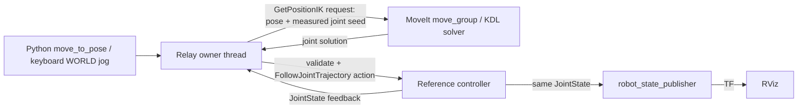

# MoveIt：手先の指令を関節の指令へ変える

`ros2-moveit` backendは、前段の[関節操作](ros2.md)と[RViz表示](ros2-rviz.md)へMoveItのIKサービスを追加する。
付属の6軸参照モデル用。MoveIt Servo、経路計画、衝突回避、物理シミュレータ、実機制御の実装ではない。
PR #7のROS 2参照機能の一部。[一区切りの範囲と検証](ros2-milestone.md)も参照。

## 何を誰が計算するか



1. 自分たちのコードは「手先をここへ」というWORLD座標の目標を決める。
2. Relayが、現在の関節角度をseedとして`/relay_reference/compute_ik`へ送る。
3. **MoveItのKDL solverが逆運動学を解く**。返答は名前付きの関節角度で、まだロボットへの送信ではない。
4. Relayが返答の関節名・有限値・上下限・現在角度からの変化量を確認する。URDFの順運動学で、返答が要求した位置・姿勢に対応するかも確認する。
5. 検査を通った関節目標だけを、これまでの`FollowJointTrajectory` actionへ送る。権限・停止・出所付き記録は既存の共通層を通す。
6. 参照コントローラが数値を補間し、JointStateを送る。RVizはその値から表示する。

PythonでMoveItのエンジン自体をimportする構成ではない。launchで起動したC++の`move_group`へ、rclpyのservice clientから送る。Python側は通信型`moveit_msgs.srv.GetPositionIK`をimportしている。
[公式service定義](https://github.com/moveit/moveit_msgs/blob/ros2/srv/GetPositionIK.srv)と[IK requestの型](https://github.com/moveit/moveit_msgs/blob/ros2/msg/PositionIKRequest.msg)も参照。

## 最小のコード

操作画面のPython欄で実行する。現在の姿勢を保ったまま3cm上へ移動する。

```python
s = get_robot_state()
p = s['robot_cartesian_pos'][:3]
RESULT = move_to_pose([p[0], p[1], p[2] + 0.03], max_actions=30)
```

`position_m`は絶対XYZ、単位はm。quaternionを省略すると現在の向きを保つ。
`move_to_pose()`は少しずつ目標へ近づける。その都度IKを依頼し、実行後にJointStateを読む。到達判定の位置許容誤差は3mm。
関節角度を直接指定する`move_joints()`も残す。手先位置・姿勢は`world`基準の`tool_link`で、指先中心ではない。

キーボードもこのbackendでは**手先のWORLD操作**になる。H → Space＋W/Sは±X、A/Dは±Y、R/Fは±Z、C/Vは閉／開。Escで停止。
1回の正規化入力は既定で3mm／0.015radに変換し、速度スライダー・Shiftで縮小する。

## 起動

リポジトリのルートから実行する。MoveItを入れるのは任意の`moveit` Docker targetだけで、既存のheadless／RViz targetは維持する。

```bash
docker build --target moveit -t relay:ros2-moveit-humble docker/ros2
mkdir -p output/ros2-moveit-session
docker run -d --init --name relay-ros2-moveit \
  -e ROS_DOMAIN_ID=76 -e ROS_LOCALHOST_ONLY=1 \
  -p 127.0.0.1:8883:8883 -p 127.0.0.1:6084:6080 \
  --mount type=bind,src="$(pwd)/relay",dst=/workspace/relay,readonly \
  --mount type=bind,src="$(pwd)/capx",dst=/workspace/capx,readonly \
  --mount type=bind,src="$(pwd)/configs/relay",dst=/workspace/configs/relay,readonly \
  --mount type=bind,src="$(pwd)/tests",dst=/workspace/tests,readonly \
  --mount type=bind,src="$(pwd)/output/ros2-moveit-session",dst=/output \
  relay:ros2-moveit-humble
```

同名コンテナが既にあれば用途と出力先を確認してから扱う。VNCは認証なしのローカル閲覧用で、ホストの127.0.0.1だけに公開する。

端末1：参照コントローラ・robot_state_publisher・RViz・MoveItを起動。

```bash
docker exec -it relay-ros2-moveit bash
source /opt/ros/humble/setup.bash
ros2 launch /workspace/relay/ros2/reference_moveit.launch.py
```

参照コントローラは特異姿勢を避けた`[0, .35, -.6, 0, .4, 0]`radから開始する。これは数値参照ノードの初期値で、既存セッションや実機をリセットする処理ではない。
画面不要の通信テストでは、launchコマンド末尾に`start_rviz:=false`を付けてRVizだけを省略できる。既定値は表示あり。

端末2：手先操作用のRelayを起動。

```bash
docker exec -it relay-ros2-moveit bash
source /opt/ros/humble/setup.bash
/opt/relay-venv/bin/python -m capx.extensions.hybrid.server \
  --backend ros2-moveit --backend-config configs/relay/ros2-moveit-reference.json \
  --manual-only --bind-host 0.0.0.0 --port 8883 \
  --output /output/user-session --max-seconds 14400
```

[操作画面8883](http://127.0.0.1:8883/)と[RViz 6084](http://127.0.0.1:6084/vnc.html?autoconnect=1&resize=scale)を並べる。キーは操作画面側で押す。
終了時はRelayをCtrl+Cで止めて保存し、次にlaunchをCtrl+Cで終了する。他のGenesis／ROS 2コンテナは操作しない。
MoveIt 2.5.10の終了処理でクラッシュするケースが残っているため、[参照版の既知制限](ros2-milestone.md)を参照。launchの終了コードだけで全プロセスの正常終了を判断しない。

```bash
source /opt/ros/humble/setup.bash
ros2 service list -t
ros2 interface show moveit_msgs/srv/GetPositionIK
ros2 action list -t
```

`compute_ik`・`compute_fk`はservice、`follow_joint_trajectory`はaction。
このlaunchではMoveItのMoveAction／ExecuteTrajectory等をロードせず、MoveItからの実行を無効にする。HumbleのMoveItCppは起動時にcontroller managerも生成するため、空のSimpleControllerManagerを入れている。実行用のcontroller handleは0個で、送信先actionはRelay側だけが使う。
起動ログのcollision geometry／3D sensor／controller_namesに関する警告・診断は、表示モデルのみ・センサーなし・MoveIt側の実行先なし、というこの参照構成に対応する。

## 実装と記録

| ファイル | 自分たちの実装 |
|---|---|
| `relay/backends/ros2_moveit.py` | IKのservice client、モデル照合、返答検査、関節指令への変換 |
| `relay/ros2/model.py` | 測定した関節角度からの軽い順運動学。IK停止時も観測・記録を継続するためローカルで計算。MoveItのFKとTFに対して検証 |
| `relay/ros2/assets/reference_arm.srdf` | `relay_arm` groupのbase_link→tool_link、ready姿勢 |
| `relay/ros2/reference_ik.launch.py` | KDL solver、MoveItの計算サービス用設定。既存の参照controllerへ付ける場合はこちらだけ起動できる |
| `relay/ros2/reference_moveit.launch.py` | 参照controller・既存のRViz launch・IK launchをまとめて起動 |
| `configs/relay/ros2-moveit-reference.json` | 接続先・単位付きゲイン・期限 |

接続時にMoveIt側のURDF・SRDF・solverを照合する。今回は付属の6軸profileに限定する。
native actionは引き続き絶対関節rad×6＋グリッパーmで、手先変位やOpenVLAの7次元OSC指令とは別。
`steps.jsonl`の`backend_diagnostics.moveit_ik`へ、手先目標、seed、IKの解、solver、service名、採用した増分の倍率を記録する。
関節の変化が大きすぎる場合は要求増分を最大3回半減して近傍の解を探す。手先の直線軌道や衝突しない経路を保証する処理ではない。

## 期限と範囲

IKのservice待ちは複数の小さい要求を含めて既定0.4秒。タイムアウトすると未処理の返答を外し、後から返っても指令に使わない。IK失敗・上下限違反・seedが変わった場合も関節指令を送らない。
同じ方向へ移動を重ねて可動域を出た場合もIKは失敗する。それまでに実行した操作を取り消す処理ではなく、各stepの記録を残してその要求を停止する。
送信後のaction期限・測定結果の記録は前段と同じ。Escや入力失効は共通層で扱い、実行中の有限時間呼出しの処理後に停止する。実機の即時安全停止を保証するものではない。

物理・接触・衝突モデルがなく、IKには明示的に`avoid_collisions=False`を指定する。URDFで対応する手先姿勢になっても、物体との接触やタスク成功を意味しない。
reset・checkpoint・巻き戻しは非対応。RViz画像をpolicy観測へ転用していない。実VLA／LLMからROS 2を操作する評価、MoveIt Servo、経路計画や実ロボット向け構成は今回の検証外。

## 検証

```bash
docker exec -e RELAY_TEST_ROS2=1 -e RELAY_TEST_ROS2_VIEW=1 -e RELAY_TEST_MOVEIT=1 \
  -e PYTEST_DISABLE_PLUGIN_AUTOLOAD=1 relay-ros2-moveit bash -c \
  'source /opt/ros/humble/setup.bash; /opt/relay-venv/bin/python -m pytest tests/test_ros2_backend.py tests/test_ros2_view.py tests/test_ros2_moveit.py -q --disable-warnings'
```

20件通過。実MoveItのIK／FK、変換だけでは関節が動かないこと、コード／キー操作、実TF、記録、存在しないサービス、期限後に返答するテストサービス、IKエラー時に前の解を使わないことを確認した。
試験前の姿勢合わせも有限の関節指令で実行し、`joint-setup.json`へ本試験と別に保存する。backendにresetやsnapshotを追加したものではない。
[検証記録](verification/ros2-moveit-20261102.md)と機械可読の結果を参照。
