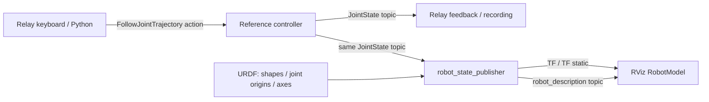

# ROS 2：受信した関節角度をRVizで見る

前段の[関節指令・フィードバック・記録](ros2.md)に、URDFと標準のrobot_state_publisher／RVizを追加する。
同じ`feat/ros2-joint-backend`、PR #7で開発している。

付属URDFはRelayの6関節＋グリッパーに合わせた簡単な表示用モデルで、Pandaのモデルではない。参照コントローラは引き続き数値補間のみ。物理・接触・実機・MoveIt／逆運動学はこの段階では含まない。

## 今回の通信



1. Relayが目標関節角度をactionで送る。
2. 参照コントローラが角度を更新し、`/relay_reference/joint_states`へ送る。
3. `robot_state_publisher`が**その値**とURDFから各linkの位置・向きを計算する。これは順運動学で、逆運動学ではない。
4. `/tf`・`/tf_static`で座標変換を配信する。
5. RVizがURDFの形状を、そのTFに合わせて描く。

表示のための`joint_state_publisher`やGUIスライダーは起動しない。JointStateのpublisherはコントローラ1個だけで、Relayとrobot_state_publisherが同じtopicを読む。
標準ノードの役割は[robot_state_publisher公式説明](https://github.com/ros/robot_state_publisher/tree/humble)も参照。

## 起動

リポジトリのルートで実行する。表示用Docker targetだけにRViz、robot_state_publisher、Xvfb、noVNCを加える。既存のheadless targetとROS 2学習用コンテナは維持する。

```bash
docker build --target visualization -t relay:ros2-rviz-humble docker/ros2
mkdir -p output/ros2-rviz-session
docker run -d --init --name relay-ros2-rviz \
  -e ROS_DOMAIN_ID=75 -e ROS_LOCALHOST_ONLY=1 \
  -p 127.0.0.1:8882:8882 -p 127.0.0.1:6083:6080 \
  --mount type=bind,src="$(pwd)/relay",dst=/workspace/relay,readonly \
  --mount type=bind,src="$(pwd)/capx",dst=/workspace/capx,readonly \
  --mount type=bind,src="$(pwd)/configs/relay",dst=/workspace/configs/relay,readonly \
  --mount type=bind,src="$(pwd)/tests",dst=/workspace/tests,readonly \
  --mount type=bind,src="$(pwd)/output/ros2-rviz-session",dst=/output \
  relay:ros2-rviz-humble
```

同名コンテナが既にあれば、作り直さず`docker ps -a`で用途と出力先を確認する。VNCは認証なしのローカル閲覧用で、上の通りホストの127.0.0.1だけに公開する。ホストのX11設定や`xhost`変更は不要。
Dockerの起動スクリプトは仮想ディスプレイを用意するだけで、ROSノードは次のコマンドで明示的に起動する。

端末1：参照コントローラ・robot_state_publisher・RVizを起動。

```bash
docker exec -it relay-ros2-rviz bash
source /opt/ros/humble/setup.bash
ros2 launch /workspace/relay/ros2/reference_view.launch.py
```

端末2：Relayのキーボード画面と記録を開始。

```bash
docker exec -it relay-ros2-rviz bash
source /opt/ros/humble/setup.bash
/opt/relay-venv/bin/python -m capx.extensions.hybrid.server \
  --backend ros2 --backend-config configs/relay/ros2-reference.json \
  --manual-only --bind-host 0.0.0.0 --port 8882 \
  --output /output/user-session --max-seconds 14400
```

- [キーボード操作画面](http://127.0.0.1:8882/)：こちらをクリックしてH → Space＋A/Dで肩の関節2を動かす。
- [RViz画面](http://127.0.0.1:6083/vnc.html?autoconnect=1&resize=scale)：腕の姿勢が変わる。Space＋Cで閉、Vで開。移動キーは操作画面側で押す。

操作速度を上げてSpace＋Aを1秒程度押すと変化を確認しやすい。Escで停止する。前段と同じくreset／巻き戻し非対応で、接続し直しても関節角度は初期化しない。
終了時はまずRelayをCtrl+Cで止めて保存し、その後端末1のlaunchをCtrl+Cで止める。表示コンテナだけを停止する場合は`docker stop relay-ros2-rviz`。他のコンテナは操作しない。

## コードの見る場所

| ファイル | 役割 |
|---|---|
| `relay/ros2/reference_view.launch.py` | 3プロセスの起動。`Node(package='robot_state_publisher', executable='robot_state_publisher')`等はROSパッケージにある実行ファイル |
| `relay/ros2/assets/reference_arm.urdf` | linkの形状、jointの親子・取付位置・回転軸・上下限。角度そのものを毎回書き換えるファイルではない |
| `relay/ros2/assets/reference.rviz` | Fixed Frame=`world`、RobotModelのdescription topic、視点、表示色 |
| `relay/ros2/reference.py` | 自分たちの参照コントローラ。JointStateの送信元 |
| `relay/backends/ros2.py` | Relay内のaction clientとJointState subscription |

launchはJointStateの名前を`/relay_reference/joint_states`へremapする。robot_descriptionの渡し先は`/relay_reference/robot_description`。TFのframe名はURDFの`world`、`base_link`、`tool_link`等で、ノード名やtopic名とは別。
同じdomainで既存の参照コントローラを見るだけなら、launchに`start_reference:=false`を付ける。二つ目のcontrollerを起動しない。

```bash
source /opt/ros/humble/setup.bash
ros2 node list
ros2 topic info /relay_reference/joint_states  # publisher 1、通常subscriber 2
ros2 topic echo /relay_reference/joint_states --once
ros2 run tf2_ros tf2_echo world tool_link
```

`tf2_echo`をCtrl+Cで止める。RViz左側の`Global Status: Ok`を確認し、TFのcheckboxを有効にすると座標軸も見られる。
モデルが出ない場合は、Fixed Frame、description topic、JointStateのpublisherの数、`world → tool_link`のTFの順に確認する。

## 検証と範囲

```bash
docker exec -e RELAY_TEST_ROS2=1 -e RELAY_TEST_ROS2_VIEW=1 \
  -e PYTEST_DISABLE_PLUGIN_AUTOLOAD=1 relay-ros2-rviz bash -c \
  'source /opt/ros/humble/setup.bash; /opt/relay-venv/bin/python -m pytest tests/test_ros2_backend.py tests/test_ros2_view.py -q --disable-warnings'
```

13件通過。実際のrobot_state_publisherとTFを使い、関節操作・グリッパー操作後のTFが独立したURDF順運動学の計算と一致すること、記録結果、JointStateのpublisherが1個であることを確認した。
ブラウザの描画確認は[検証記録](verification/ros2-rviz-20261102.md)に残す。

RVizは表示だけを担当し、goalを受けたコントローラとは別ノード。VLA／VLMの観測画像は引き続き明示したJointState模式表示で、RVizのスクリーンショットへ置き換えていない。
URDFはvisualのみの表示用モデルで、接触や慣性を扱う物理モデルではない。[MoveItによるIK・手先操作](ros2-moveit.md)は別backendとして追加した。Gazeboでの物理制御や実機向け構成は別途検証する。
