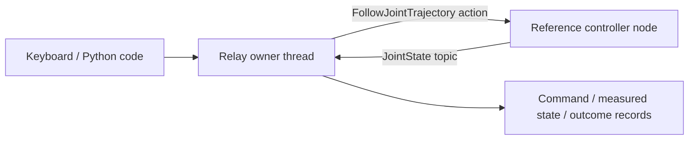

# ROS 2：関節指令・フィードバック・記録

`feat/ros2-joint-backend`の最初の接続です。RelayをROS 2 Humble環境で実行し、標準の`control_msgs/action/FollowJointTrajectory`へ目標角度を送ります。`sensor_msgs/msg/JointState`から測定角度と時刻を読み、指令・結果・出所を記録します。

付属ノードは**数値の参照コントローラ**です。物理、接触、ロボット形状、実カメラ、MoveIt／IKはありません。画面の棒グラフは受信したJointStateの模式表示です。既存のGenesis／LIBERO画面やROS 2学習用コンテナとは別に起動します。



## 起動

Docker Desktopが起動済みの環境で、リポジトリのルートから実行します。macOS側にrclpyをインストールする必要はありません。イメージには公式ROS 2ベースと必要なPython／message依存だけを入れます。学習用コンテナは操作しません。

```bash
docker build -t relay:ros2-humble docker/ros2
mkdir -p output/ros2-session
docker run -d --init --name relay-ros2-dev \
  -e ROS_DOMAIN_ID=74 -e ROS_LOCALHOST_ONLY=1 \
  -p 127.0.0.1:8881:8881 \
  --mount type=bind,src="$(pwd)/relay",dst=/workspace/relay,readonly \
  --mount type=bind,src="$(pwd)/capx",dst=/workspace/capx,readonly \
  --mount type=bind,src="$(pwd)/configs/relay",dst=/workspace/configs/relay,readonly \
  --mount type=bind,src="$(pwd)/tests",dst=/workspace/tests,readonly \
  --mount type=bind,src="$(pwd)/output/ros2-session",dst=/output \
  relay:ros2-humble
```

同名コンテナが存在する場合は作り直さず、`docker ps -a`でその用途・出力先を確認してください。既存の`.local`、モデル、認証情報、`.git`はマウントしません。Webはホストのloopbackだけへ公開します。

端末1：標準actionを受けるノードを起動します。

```bash
docker exec -it relay-ros2-dev bash
source /opt/ros/humble/setup.bash
/opt/relay-venv/bin/python -m relay.ros2.reference
```

端末2：Relayを起動します。コンテナ内だけ`0.0.0.0`で待ち受けます。Host／Origin／tokenのチェックは維持しています。ホストとコンテナのWebポートを同じ8881にしてください。

```bash
docker exec -it relay-ros2-dev bash
source /opt/ros/humble/setup.bash
/opt/relay-venv/bin/python -m capx.extensions.hybrid.server \
  --backend ros2 --backend-config configs/relay/ros2-reference.json \
  --manual-only --bind-host 0.0.0.0 --port 8881 \
  --output /output/user-session --max-seconds 14400
```

[操作画面](http://127.0.0.1:8881/)でH → Space＋W/Sで関節1、A/Dで関節2、R/Fで関節3、Z/Xで関節4、Q/Eで関節6を操作します。Space＋Cは閉、Vは開。速度スライダーとShiftで微調整できます。これは手先XYZ操作ではありません。関節5は次のPythonコードで操作できます。

```python
s = get_robot_state()
q = s['robot_joint_pos'][:]
q[4] += 0.04  # arm_joint_names[4]の測定角度から+0.04 rad
RESULT = move_joints(q, max_actions=10)
```

Escは操作権限を無効化し、owner threadが実行中の有限時間goalの終了／cancelを処理します。通常のgoalは0.1秒、結果待ちは0.6秒、cancel応答待ちは追加最大0.2秒です。ネットワーク越しの実機の安全停止を保証するものではありません。終了時はRelayをCtrl+Cで止めると記録が保存されます。参照ノードは別のCtrl+Cで終了します。

## ROS 2の通信を確認する

同じコンテナの端末で、毎回ROS環境をsourceして実行します。参照ノードとRelayの両方が起動中の例です。

```bash
source /opt/ros/humble/setup.bash
echo "$ROS_DOMAIN_ID"  # 74
ros2 node list
ros2 action list -t
ros2 topic list -t
ros2 topic echo /relay_reference/joint_states --once
ros2 interface show control_msgs/action/FollowJointTrajectory
```

- `/relay_backend_<id>`：Relay内のrclpyノード。action clientとJointState subscription。
- `/relay_reference_controller`：付属のaction serverとJointState publisher。
- `/relay_reference/follow_joint_trajectory`：action名。ノード名そのものではありません。
- `/relay_reference/joint_states`：topic名。両ノードが同じ型・名前・domainで通信します。

## 指令と記録の意味

設定は[ros2-reference.json](../configs/relay/ros2-reference.json)、実装は`relay/backends/ros2.py`、参照ノードは`relay/ros2/reference.py`です。

- native actionは`joint1..joint6`の**絶対角度rad**と`gripper_joint`の**絶対開き幅m**。既定の7次元でもOpenVLAの7次元OSC変位とは異なります。名前と単位を含む専用`action_contract`を使います。
- 名前・順序・上下限・グリッパー幅・一回の角度変化上限は`JointProfile`で明示します。未知の関節へ暗黙に指令しません。既定は±1.5rad、1回最大0.05rad、グリッパー0〜0.04mです。
- `step`は**1回の有限時間trajectory指令の試行と観測結果**。物理エンジンの積分stepではありません。`steps.jsonl`の`backend_diagnostics`へgoal ID・結果・測定角度・JointState時刻・freshnessを残します。
- 結果timeout・拒否・不一致は記録して試行を打ち切ります。timeout前に動いている場合もあるため「未実行」とは扱いません。新指令を送る前の古いfeedbackは拒否します。送信元のheader時刻と受信時刻の両方を検査します。ROS clock／時刻同期を前提とします。
- reset・巻き戻し・再実行は非対応。`new trial`と分岐図を無効にし、物理状態の復元を装いません。再接続してもロボットの角度を初期化しません。
- `--manual-only`ではLLM／VLAは接続しません。Pythonコードは既存のコード実行器から使えます。LLM向けtool一覧も関節制御用になり、Cartesian toolは提示しません。実LLMからROS 2までの生成試験とVLA用のjoint policyは今回の検証外です。

標準actionとの境界は[ros2_controlのJoint trajectory controllerドキュメント](https://control.ros.org/humble/doc/ros2_controllers/joint_trajectory_controller/doc/userdoc.html)に合わせています。付属ノードはros2_control本体を起動したものではありません。別のcontrollerへはaction名・state topic・正確なjoint profileを合わせる必要があり、複数controllerへの協調送信や独立したgripper actionはまだ実装していません。

## 次の段階

実際のロボットモデルをRVizに出すにはURDFとrobot_state_publisherが必要です。手先操作にはMoveIt Servo／IKを行う別adapter、Gazeboでの物理動作にはモデル・ros2_control controller・state publisherの構成が必要です。Genesisは既存の直接backendで動き、このROS 2接続を必須にしません。共通の権限・記録・コード実行層は維持します。

## テスト

参照ノードを起動した状態で実行します。ROS環境に同梱のlaunch_testing pluginが無関係な上流テストを収集するため、plugin自動読込をこのコマンドだけ無効にします。

```bash
docker exec -e RELAY_TEST_ROS2=1 -e PYTEST_DISABLE_PLUGIN_AUTOLOAD=1 \
  relay-ros2-dev bash -c 'source /opt/ros/humble/setup.bash; /opt/relay-venv/bin/python -m pytest tests/test_ros2_backend.py -q --disable-warnings'
```

キーボード相当入力、Pythonコード、関節5、グリッパー、記録、source時刻が古いfeedbackの拒否、応答timeout後の観測と記録を実際のDDS/action通信で検証します。参照ノードはこの接続の試験用で、実機や物理シミュレータの動作確認ではありません。
