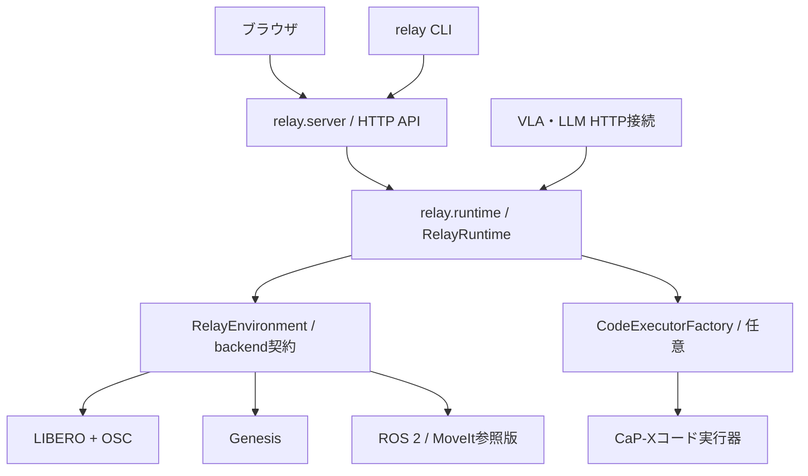

# Relay Runtime

Runtimeは操作権の切替・停止・指令の期限・記録・checkpoint・分岐・経路採用を担当する。
CaP-XやGymをimportせず、ブラウザとCLIの両方から同じHTTP APIで操作できる。
このリポジトリ全体は引き続きCaP-Xのforkであり、上流のコード・ライセンス・履歴は保持する。



## 配置と責務

| 場所 | 担当 |
|---|---|
| `relay/runtime/runner.py` | `RelayRuntime`、所有者スレッドでの動作適用、処理の中断 |
| `relay/runtime/control.py` | mode・epoch・lease・手動入力の期限 |
| `relay/runtime/history.py` / `recording.py` | 状態復元、分岐、採用、画像・指令・出所の記録 |
| `relay/runtime/tools.py` | SDK非依存の`RobotTools`。動作は環境契約へ委譲 |
| `relay/runtime/execution.py` | 実行器のProtocolと、停止可能な子プロセス通信 |
| `relay/policy/` | VLAのaction契約・HTTP転送・LLM HTTPクライアント |
| `relay/server.py` / `relay/web/` | HTTP console、起動CLI、画面の実体 |
| `relay/integrations/capx.py` | 選択時だけCaP-Xを読み込むコード実行アダプタ |
| `relay/backends/` | SDK別実装。SDKの導入は別途必要 |

Runtimeの基本依存はNumPy・SciPy・Pillow。付属`kinematic`は物理を持たない数値サンプル。
Genesis・ROS 2・LIBEROを使うときだけ、対応SDKとbackend設定が必要になる。
巻き戻し可能性はbackendの能力で決まり、今回の分離によってROS 2参照版が巻き戻せるようになるわけではない。

## まずcheckout内で起動

必要なPython依存がある既存の開発環境では、リポジトリのルートから実行する。

```bash
python -m relay.server --backend kinematic --manual-only \
  --port 8876 --output output/runtime-demo
python -m relay --url http://127.0.0.1:8876 status
```

新しい入口の既定値は`--backend kinematic --code-executor disabled`。
手動・VLA・記録・履歴はコード実行器なしでも動作する。
VLAの接続は既存の[接続ガイド](genesis-vla.md)のworker設定を使う。

## CaP-Xを含めずに配布・インストール

Python 3.10〜3.12を使用する。以下は専用venvへのローカルインストール例で、PyPIへの公開ではない。
staging先は既存のディレクトリを再利用せず、新しく指定する。

```bash
python scripts/package_relay_runtime.py --output /tmp/relay-runtime-src
uv build --wheel --out-dir /tmp/relay-runtime-dist /tmp/relay-runtime-src
uv venv --python 3.12 /tmp/relay-runtime-venv
uv --no-config pip install --python /tmp/relay-runtime-venv/bin/python \
  /tmp/relay-runtime-dist/relay_runtime-0.1.0-py3-none-any.whl
cd /tmp
/tmp/relay-runtime-venv/bin/relay-serve --backend kinematic --manual-only \
  --port 8876 --output /tmp/relay-session
/tmp/relay-runtime-venv/bin/relay --url http://127.0.0.1:8876 status
```

`--no-config`はcheckoutの上流向けuv依存overrideを、この独立した環境へ持ち込まないために指定する。
配布物は`relay/`と必要なUI・ROSモデル等のデータ、metadata、MITライセンスのみを含む。
`relay/_source_manifest.json`で収録ファイルのSHA256を確認できる。
CaP-X・Gym・Torch・シミュレータSDK、モデル重み、操作記録や接続tokenは含めない。

**独立配布物と、このfork全体のインストールは代替の方法。**
どちらも`relay`パッケージを所有するため、同じvenvへ重ねてインストールしない。
CaP-X実行器を使う場合は、既存の検証済みCaP-X checkout環境を使用する。

## コード実行器を選ぶ

CaP-Xのコード実行を使う開発環境では、明示的に有効にする。

```bash
python -m relay.server --backend genesis \
  --backend-config configs/relay/genesis-panda.json \
  --code-executor capx --llm-url http://127.0.0.1:8000 --llm-model YOUR_MODEL_ID \
  --port 8878 --output output/genesis-code
```

LLM URL・モデル名等は[LLM接続ガイド](genesis-llm.md)の実サーバー設定に合わせる。
実行器なしでLLMを指定すると起動時に拒否し、画面でもコード実行ボタンを無効にする。
LLMはコードを生成し、実行器がそのコードから許可されたtoolを呼ぶ。シミュレータを操作するのはRuntime側。
今回、新しいPython実行sandboxや、新しいLLMモデルは実装していない。

独自実行器はライブラリ利用時に`RelayRuntime(..., code_executor_factory=Factory)`へ注入できる。
Factoryは`code, prompt, lease, timeout`から`CodeExecution`を返す。
Runtimeはtool要求と`done(ok, info)`／`failed(error)`だけを解釈し、CaP-X固有のreturn codeには依存しない。
`close()`は子プロセスを終了・joinし、操作権を失った処理の指令は既存leaseで拒否する。
HTTP起動CLIに任意の未検証モジュールをロードする新機能は追加していない。

## 互換性と残すもの

- 旧`capx.extensions.hybrid.server`は既定のLIBERO・CaP-X実行器を維持する互換起動入口。
- 旧control・history・policy・recording等のimport先は新実体のalias。旧`HybridRunner`はCaP-X実行器を既定注入するwrapper。
- 旧UIのパスは新assetsへのsymlinkで保持し、稼働中の旧consoleからも読み込める。Windows checkoutでのsymlink動作は未検証。
- HTTPパス・認証header・記録のschema名は変更しない。`code_ready`・`code_executor`は状態への追加項目。
- LIBEROのtask初期化は`relay/backends/libero_task.py`へ分離した。LIBERO／MuJoCo／robosuite自体は別SDK。
- OpenVLA等のモデルworker・CaP-Xベンチマーク・学習コードまで全て移動したわけではない。GPU worker配布スクリプトは新policyモジュールを含めるよう更新。
- 元の提出タグとROS参照タグは保持する。以前の資料が示す起動方法も維持する。

検証範囲と実測は[分離の確認記録](verification/runtime-extraction-20261102.md)を参照。
